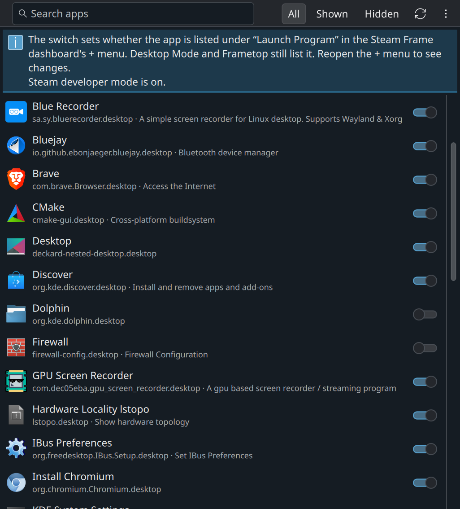

# Plusmenu-Settings

Hides apps from the Steam Frame dashboard's + menu without uninstalling them. Desktop Mode and the Frametop desktop still list them.



## How it works

The + menu's "Launch Program" section comes from `SteamClient.Apps.ScanForInstalledNonSteamApps()`, the same scan "Add a Non-Steam Game" uses. Steam runs it with `XDG_CURRENT_DESKTOP=gamescope` over the `.desktop` files in `~/.local/share/applications`, the Flatpak exports, `/usr/local/share` and `/usr/share`, the first file of a name winning.

- The scan leaves out `NotShowIn`/`OnlyShowIn` (for `gamescope`), `NoDisplay`, `Hidden`, a missing `TryExec` program, `Terminal=true`, and `steam://` shortcuts (games are in the library).
- The dashboard then drops apps whose executable is `steam` or `vrurlhandler`, and, unless Steam's developer mode is on, `firewall-config, vlc, dolphin, cmake-gui, plasma-discover, konsole, systemsettings, qrenderdoc, sh, lxterminal`. "Install Chromium" always stays.

When it can, the app reads the developer mode setting through Steam's local CEF debugging port (127.0.0.1:8080). Entries the menu never shows are only listed through "List entries the menu never shows" and can't be switched.

Hiding an app adds `NotShowIn=gamescope;` without touching system files:

- **File already in `~/.local/share/applications`**: the key goes in that file, with the mark `X-PlusmenuSettings-Added=true`. Showing the app again takes both out.
- **Any other app**: a copy goes there with `NotShowIn=gamescope;` and `X-PlusmenuSettings-Copy=true`. Showing the app again deletes it. With Frametop installed, the copy is built with Frametop's own `ft_apps.standalone()`, so the app keeps "Launch as Standalone" in the Frametop desktop.

Reopen the + menu to see changes.

## Background service

The apps you hide are also remembered in `~/.local/state/plusmenu-settings/hidden.json`. `plusmenu-settings sync` brings their entries up to date:

- an entry that an install or update rewrote (e.g. reinstalling Frametop) is hidden again;
- a copy whose app's desktop file changed (e.g. a Flatpak or SteamOS update) is rebuilt from the new file;
- a copy whose app was uninstalled is deleted, so no dead entry stays in the KDE menus. If the app comes back, it's hidden again.

`install.sh` sets up systemd user units that run it: `plusmenu-settings-sync.path` whenever an applications folder changes, and `plusmenu-settings-sync.timer` a minute after login and every hour (Flatpak updates only change where its links point, which the folder watch doesn't see). Its log: `journalctl --user -u plusmenu-settings-sync`.

## Install

In a terminal on the Steam Frame (Desktop Mode or Frametop):

```
curl -fsSL https://raw.githubusercontent.com/superpaiku/plusmenu-settings/main/get.sh | bash
```

That downloads the latest release to `~/.local/share/plusmenu-settings`, checks its SHA-256, and installs the `plusmenu-settings` command, the "Plusmenu-Settings" menu entry and the background service. Run it again to update. To uninstall, add `-s -- --remove` after `bash`.

Or download `plusmenu-settings.tar.gz` from the [latest release](https://github.com/superpaiku/plusmenu-settings/releases/latest), unpack it, and run `./install.sh` in the `plusmenu-settings` folder. Keep the folder: the command runs from there.

## Usage

```
./install.sh                          # plusmenu-settings command + "Plusmenu-Settings" menu entry
plusmenu-settings                     # open the window
plusmenu-settings list [--hidden]
plusmenu-settings hide vlc.desktop
plusmenu-settings show vlc.desktop
./install.sh --remove
```

## Requirements

SteamOS on the Steam Frame, with Python 3, Qt 6's `qml6` runtime and KDE's Kirigami (all preinstalled). The window is a Kirigami UI (`plusmenu_settings.qml`) run by `qml6`; it talks to `plusmenu_settings.py` through a local API on 127.0.0.1 that only it has the key to. No root access needed: everything lives in your home folder.

## Known limits

- After an install or update, an app can show up in the + menu for a few seconds (up to an hour for a Flatpak update) until the service hides it again.
- The Frametop session points `XDG_CONFIG_HOME` and `XDG_RUNTIME_DIR` to its own folders; `install.sh` uses the standard locations and the login's systemd, so run it from any terminal.
- The menu's rules come from Steam's current client code and may change with a Steam update.

## License

MIT, see [LICENSE](LICENSE). Not affiliated with or endorsed by Valve.
